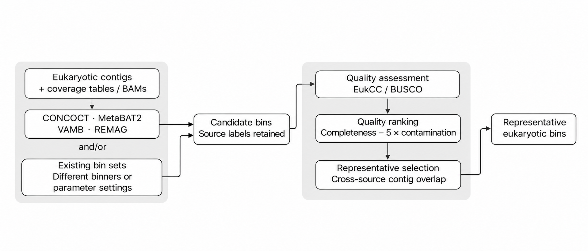

# EukBinPicker

Recover eukaryotic genome bins with complementary binning methods.

## Introduction

Genome-resolved metagenomics helps reveal eukaryotic diversity and function, but genome recovery remains challenging. A typical workflow assembles quality-controlled reads, maps reads to the complete assembly, and identifies eukaryotic contigs with [EukContigMiner](https://github.com/WeStrainGroup/EukContigMiner) or similar tools. These contigs and their coverage profiles are then used to recover eukaryotic MAGs.

Binning performance varies across samples and environments. Following the complementary-binner rationale of [DAS Tool](https://github.com/cmks/DAS_Tool), EukBinPicker (EBP) evaluates candidate bins from multiple sources and selects representatives based on quality estimates and shared contigs.

EBP integrates [CONCOCT](https://github.com/BinPro/CONCOCT), [MetaBAT2](https://bitbucket.org/berkeleylab/metabat/), [VAMB](https://github.com/RasmussenLab/vamb) and [REMAG](https://github.com/danielzmbp/remag), which use contig sequences and coverage without requiring additional information, such as prokaryotic marker genes or taxonomic assignments, for binning. It also accepts existing bin sets, alone or alongside new binning. By default, all candidates undergo the same quality assessment and selection workflow.



## Installation

Install with Conda:

```bash
conda create -n eukbinpicker --override-channels -c westraingroup -c conda-forge eukbinpicker=0.44
conda activate eukbinpicker
```

Or install a tagged release from GitHub with Git and Conda available:

```bash
git clone --depth 1 --branch v0.44 https://github.com/WeStrainGroup/EukBinPicker.git
cd EukBinPicker
bash install.sh --prefix "$HOME/conda-envs/eukbinpicker"
conda activate "$HOME/conda-envs/eukbinpicker"
```

Download reference databases separately. Provide an unpacked [EukCC database](https://github.com/Finn-Lab/EukCC) with `--eukcc-db`, or a [BUSCO lineage](https://busco.ezlab.org/) with `--busco-db`. Alternatively, set `EUKBINPICKER_EUKCC_DB` or `EUKBINPICKER_BUSCO_DB`.

## Quick start

Bin eukaryotic contigs using their coverage profiles, then select representative bins.

```bash
eukbinpicker \
  --sample sample_1 \
  --contigs euk_contigs.fa \
  --coverage assembly_depth.tsv \
  --eukcc-db /path/to/eukcc_db \
  --output sample_1_ebp
```

Select representative bins from existing bin sets for the same assembly.

```bash
eukbinpicker \
  --sample sample_1 \
  --bins /path/to/bins_A /path/to/bins_B \
  --eukcc-db /path/to/eukcc_db \
  --output sample_1_ebp
```

Run new binning and select representatives jointly with existing bins from the same assembly.

```bash
eukbinpicker \
  --sample sample_1 \
  --contigs euk_contigs.fa \
  --coverage assembly_depth.tsv \
  --bins /path/to/bins_A /path/to/bins_B \
  --eukcc-db /path/to/eukcc_db \
  --output sample_1_ebp
```

Selected FASTA files are written to `3_selection/bins/` within the output directory.

## Parameters

Default values are shown below. **—** means no preset value; input requirements are stated in the description.

### Input and output

| Parameter | Default | Description |
| --- | --- | --- |
| `--sample` | — | Required sample label: letters, digits, `.`, `_` or `-`. |
| `--contigs` | — | Eukaryotic FASTA with unique IDs; required with `--coverage`. |
| `--coverage` | — | Coverage tables or indexed BAMs; multiple files and repeated arguments accepted. |
| `--bins` | — | One directory per source, one FASTA per bin (`.fa`, `.fna`, `.fasta`, optionally `.gz`); no nested directories. Multiple inputs accepted. |
| `--cov-contig-column` | — | Contig ID column in custom tables. |
| `--cov-mean-column` | — | Comma-separated mean columns in custom tables. |
| `--cov-variance-column` | — | Comma-separated variance columns, paired with means. |
| `--output` | — | Required output directory. |

Use `--contigs` with `--coverage` for new binning, `--bins` for existing bin sets, or both. All inputs should come from the same assembly and retain the original contig IDs.

For new binning, map reads to the complete assembly. EBP extracts coverage entries matching the supplied eukaryotic FASTA; every contig must have an entry. Zero coverage is valid, but missing entries are not. Supply either BAMs or coverage tables in one run.

**BAM input.** Pass `--coverage sample_A.bam sample_B.bam`. Use coordinate-sorted, indexed BAMs with unique basenames and the same reference IDs, lengths and order. For example, map one sample's clean paired-end reads with Bowtie2 and prepare the BAM with SAMtools:

```bash
bowtie2-build assembly.fa assembly_index
bowtie2 -x assembly_index \
  -1 sample_A.clean_R1.fq.gz -2 sample_A.clean_R2.fq.gz \
  --very-sensitive --no-unal --seed 6311 -p 4 \
  | samtools sort -@ 4 -o sample_A.bam -
samtools index sample_A.bam
```

For additional samples, repeat the mapping, sorting and indexing with the same assembly index. EBP uses these alignments without remapping reads.

**JGI tables.** Alternatively, generate a coverage table from the BAMs, with one mean/variance pair per sample:

```bash
jgi_summarize_bam_contig_depths \
  --outputDepth assembly_depth.tsv \
  sample_A.bam sample_B.bam
```

Pass `--coverage assembly_depth.tsv`; EBP recognizes the [JGI format](https://bitbucket.org/berkeleylab/metabat/src/master/) automatically. For single-sample coverage, use one BAM.

**Custom tables.** You can also supply a tab-separated table with a header, unique contig IDs and finite, non-negative coverage values. For columns named `sequence_id`, `A_mean`, `B_mean`, `A_var` and `B_var`, add:

```bash
--cov-contig-column sequence_id \
  --cov-mean-column A_mean,B_mean \
  --cov-variance-column A_var,B_var
```

Variance is optional; if provided, pair it with the mean columns in the same order. Only MetaBAT2 uses variance, requiring it for all samples or none; mean-only input uses its native `--cvExt` mode. The other three binners use mean coverage.

### Binning

| Parameter | Default | Description |
| --- | --- | --- |
| `--min-input-length` | `1500` | Minimum contig length for binning, in bp; imported bins remain intact. |
| `--binners` | `all` | All four tools or a comma-separated subset of `remag,concoct,metabat2,vamb`. |
| `--min-retain-size` | `200000` | Minimum bin size to retain, in bp; `0` disables this filter. |
| `--remag-parameters` | — | Quoted native REMAG options. |
| `--concoct-parameters` | — | Quoted native CONCOCT options. |
| `--metabat2-parameters` | — | Quoted native MetaBAT2 options. |
| `--vamb-parameters` | — | Quoted native VAMB options. |
| `--binning-only` | `F` | `T`: save candidates without QC or selection; omit QC/selection options. `F`: full workflow. |
| `--threads` | `4` | Threads supplied to each tool; JGI uses half (minimum 1). |
| `--gpu` | `F` | `T`: CUDA for selected REMAG/VAMB; other tools remain on CPU. `F`: CPU for all tools. |
| `--random-seed` | `6311` | Shared positive seed for binning. |

Set `--binning-only T` to save candidate bins without QC or selection, then supply their directories through `--bins` in a later run with `--binning-only F` (default), optionally alongside other binners.

EBP uses native algorithm defaults unless overridden, with shared contig-length, bin-size and random-seed settings. `--min-input-length` filters contigs for new binning; imported bins are not trimmed. MetaBAT2 requires at least 1,500 bp and VAMB at least 250 bp, so use 1,500 bp or above when running all four binners.

`--min-retain-size` applies to the total size of each bin, including imported bins. Only whole bins meeting this threshold enter `1_raw/`; imported source files remain unchanged.

For new binning, EBP applies this cutoff before FASTA export. REMAG and VAMB use native export thresholds, and CONCOCT filters bin memberships. MetaBAT2 receives the value as `--minClsSize`, which also affects cluster processing; the default matches its native 200,000-bp setting.

REMAG's classifier is skipped because the supplied contigs are expected to have already been identified as eukaryotic. CONCOCT calculates fragment coverage from BAMs, or approximates it from parent-contig means when given tables.

To customize a binner, pass native options in one quoted string. Use EBP options for input/output paths and shared settings:

```bash
eukbinpicker \
  --sample sample_1 \
  --contigs euk_contigs.fa \
  --coverage assembly_depth.tsv \
  --eukcc-db /path/to/eukcc_db \
  --output sample_1_custom \
  --concoct-parameters "--clusters 200" \
  --metabat2-parameters "--maxP 90"
```

### Quality assessment and selection

| Parameter | Default | Description |
| --- | --- | --- |
| `--min-selection-size` | `500000` | Minimum bin size entering QC and selection, in bp. |
| `--qc-tools` | `eukcc` | `eukcc`, `busco`, `eukcc,busco` or `all`. |
| `--qc-decision` | `eukcc` | Executed QC tool used for filtering and ranking. |
| `--eukcc-db` | — | Unpacked EukCC database; required when EukCC is selected. |
| `--busco-db` | — | Unpacked BUSCO lineage with `dataset.cfg` and `hmms/`; required when BUSCO is selected. |
| `--min-selection-completeness` | `0` | Minimum completeness, in %. |
| `--max-selection-contamination` | `100` | Maximum contamination or BUSCO proxy, in %. |
| `--contamination-penalty` | `5` | Contamination penalty in the ranking score. |
| `--min-overlap` | `0.50` | Overlap threshold between candidates from different sources. |

Retained bins meeting `--min-selection-size` undergo QC. Only bins with valid estimates that meet the completeness and contamination thresholds enter selection. The defaults of 0% completeness and 100% contamination are permissive; use `--min-selection-completeness` and `--max-selection-contamination` to set stricter requirements.

To rank with BUSCO, include it in `--qc-tools` and set `--qc-decision busco`. BUSCO's duplicated percentage is used as a contamination proxy.

### Information

| Parameter | Description |
| --- | --- |
| `--help` | Show command-line options. |
| `--version` | Print the installed version. |

## How selection works

Candidates passing the size and QC thresholds are ranked by:

```txt
score = completeness − contamination_penalty × contamination
```

EBP considers candidates in ranked order. If the overlap with an already selected bin from a different source reaches `--min-overlap` (default: 0.50), the candidate is excluded and assigned to that representative. Otherwise, it is selected as a new representative.

```txt
overlap(A, B) = shared_contig_bp / min(size(A), size(B))
```

Bin size is the total length of its contigs, in bp. A source is one native binner or one imported directory. Bins within a source are not compared. Shared contigs must match in original ID and normalized sequence; overlap is a proxy for competing reconstructions, not a taxonomic identity test. EBP preserves complete candidate bins without merging, splitting or refinement.

Ties are resolved by higher completeness, lower contamination, fewer contigs, higher N50, then lexicographic order of `source__bin_id`.

## Outputs

The full workflow writes the tree below; `--binning-only T` writes only `0_log/` and `1_raw/`.

```text
sample_1_ebp/
├── 0_log/
│   ├── run.json                 # Inputs, commands, status and result checksums
│   └── run.log                  # Progress, warnings and tool output
├── 1_raw/
│   └── <source>/
│       └── <original_bin>.fa    # Retained candidate bins
├── 2_qc/
│   ├── summary.tsv              # Statistics, QC metrics and status for every retained bin
│   └── evidence/
│       └── <source>/
│           └── <bin_id>/
│               ├── eukcc/       # Quality report and marker evidence, when available
│               └── busco/       # Short summary and compressed full marker table
└── 3_selection/
    ├── representatives.tsv      # Final bin IDs, original sources and quality statistics
    ├── selection.tsv            # Candidate decisions and matching representatives
    └── bins/
        ├── bin_1.fa
        ├── bin_2.fa
        └── ...
```

Final bins are numbered in selection order. `representatives.tsv` maps each new ID to its source, original bin ID and filename, and includes quality metrics, shared-contig statistics and represented candidates. `selection.tsv` records why each candidate was selected or excluded, its assigned representative and any additional matching representatives. Candidate references use `source/bin_id`.

QC evidence is grouped by source and bin; only the requested QC tools are included. `summary.tsv` distinguishes bins below the QC size threshold, unassessable bins and valid quality estimates.

`run.json` records workflow status, per-stage outcomes, actual commands and checksums. Binning-only runs record `status: binning_completed`, with QC and selection marked as skipped. A completed run may contain failed native binners; check `partial` and `summary.native_binner_status`. Valid imported bins can still be selected if native binning fails or no contigs pass the input-length threshold.

Working files stay in `.work/`. Completed stages remove them after output verification; failed stages retain them for diagnosis. To resume an interrupted or failed run, repeat the same command. EBP reuses verified completed stages and reruns unfinished ones. Use a new output directory if inputs, parameters or software change, including after an upgrade.

## Contact

Xinyu Wang: [wangxinyu30@westlake.edu.cn](mailto:wangxinyu30@westlake.edu.cn)

## License

EukBinPicker is distributed under [CC BY-NC-SA 4.0](https://github.com/WeStrainGroup/EukBinPicker/blob/main/LICENSE). External tools and databases retain their respective licenses.
